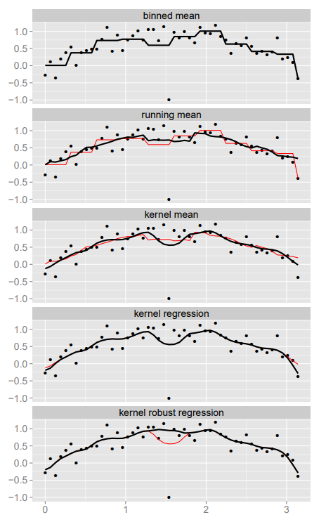

<!--
Backup of three slides removed from _framework.qmd on 2026-09-24 (lecturer's request):
"The core tension", "Smoothing: kernel methods", "Peel and transform". They were
replaced there by the single slide "Smooth, peel, transform".
Not part of the deck: lecture.qmd does not include this file, and Quarto skips files
whose names start with "_" when rendering a project. To restore, paste the slides back
into _framework.qmd in place of "Smooth, peel, transform".
-->

## The core tension

- Robust statistics are slow: the median shrugs off 50 % bad data, but is holistic
- Efficient statistics are sensitive: one outlier can move the mean arbitrarily
- "The easiest summary statistics to compute are also the least robust" (Wickham)
- The way out: fast statistics, then smoothing

::: notes
- Breakdown point: the share of arbitrarily bad data an estimator tolerates before it
  can be pushed anywhere. Mean: 1/n, i.e. 0 % for large n. Median: about 50 %
  (Rousseeuw & Hubert, WIREs 2011).
- Full quote: "the easiest summary statistics to compute are also the least robust,
  while robust statistics are usually holistic."
- Smoothing across neighbouring bins "makes it possible to use fast statistics with
  low breakdown points" (Wickham): the neighbours outvote a bad bin.
:::

## Smoothing: kernel methods

:::: {.columns}
::: {.column width="62%"}
- Neighbouring bins with *weights*
- Usual: Gaussian
- A fast one, the paper's "triweight":

  $K(x) = (1 - |x|^3)^2\, I_{|x|<1}$ \
  $k_i = K\!\left(\frac{x_j - x_i}{h}\right)$

- *h*, the bandwidth: the neighbourhood
- Bandwidth can be selected automatically
:::
::: {.column width="38%"}
{fig-alt="Five smooths of the same noisy sine curve: binned mean, running mean, kernel mean, kernel regression, kernel robust regression" height="640"}
:::
::::

::: notes
- Kernel smoothing: each bin's new value is a weighted average of its neighbours; the
  kernel K gives the weights, the bandwidth h how far they reach. The Iris example's
  ¼-½-¼ was a tiny kernel.
- The formula is as printed in Wickham (2013), who calls it the triweight and prefers
  it because it is bounded (only nearby bins count) and about 10× faster to evaluate
  than a Gaussian. Careful: it is neither textbook kernel. Triweight is (35/32)(1 − x²)³,
  tricube (70/81)(1 − |x|³)³; the paper's §4.3 says "bounded tricube kernel" and the
  bigvis code computes (1 − |x|³)³. In practice: tricube.
- Figure (the paper's Fig. 5): five smooths of sin(x) with noise and one outlier at π/2,
  from the binned mean to robust local regression; only the robust one ignores the
  outlier.
- Bandwidth: the paper picks h by leave-one-out cross-validation as a starting point,
  then lets the user adjust it interactively.
:::

## Peel and transform: taming the dynamic range

- Big data has extreme values: a few bins dwarf all the others
- On a linear scale they use up the colour range; the bulk looks flat
- Peel: drop the sparsest outer bins (often < 1 % of the data)
- Transform before mapping to colour: log, modulus, rank
- Rank-based: histogram equalization, live in the census example

::: notes
- Wickham's two tools against extremes (§5): peeling for outliers in space ("removing
  the least populated outer bins", keeping e.g. 99 % of the data) and the modulus
  transformation (John & Draper 1980, a Box-Cox variant for positive and negative
  values) for outliers in colour.
- Outliers are not thrown away for good: "it is better to partition the analysis to
  look separately at the common and at the unusual."
- Rank transforms go one step further: an equal share of colours for an equal share of
  pixels. That is eq_hist in datashader; the census part shows it live.
:::
