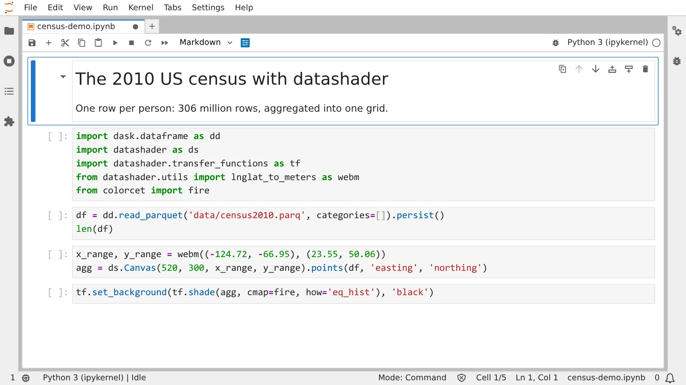
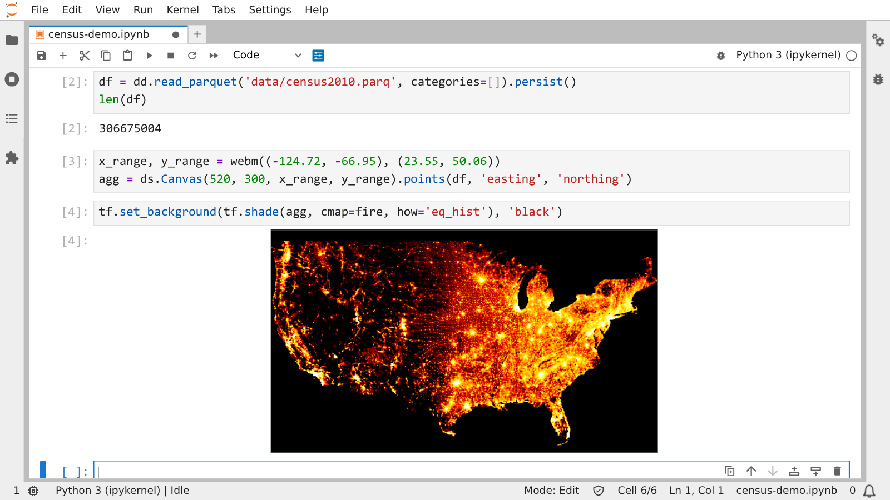
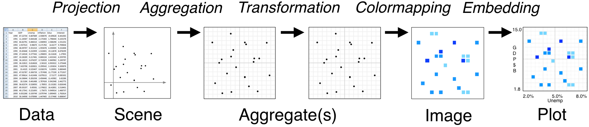
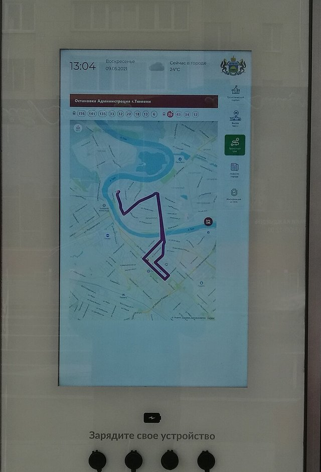

# Datashader: the framework at pixel resolution

::: notes
The bridge: datashader's pipeline is bin–summarize–smooth–plot with the pixels as the
bins. Then the census example shows it live.
:::

## Datashader: a Python library {#datashader-library}

:::: {.columns}
::: {.column width="58%"}
- Open source (BSD), part of the HoloViz family; developed with Anaconda's support
- Install: `pip install datashader` (or conda); version 0.19.1, May 2026
- Builds on NumPy, pandas, xarray and Numba; Dask for data beyond memory, cuDF / CuPy for GPUs
- [datashader.org](https://datashader.org) · [github.com/holoviz/datashader](https://github.com/holoviz/datashader)
:::
::: {.column width="42%"}
::: {style="--diagram-h: 560px"}
```{=html}

```
:::
:::
::::

::: notes
- A library, not an application: you call it from Python code. Install with
  pip install datashader or conda install datashader.
- Open source under the BSD-3 licence; originally developed with Anaconda's support,
  now maintained by Anaconda developers and the community; part of HoloViz.
- Its own dependencies are small: NumPy, pandas, xarray, Numba (which compiles the
  per-row aggregation loops to machine code), colorcet, param. Dask (larger than
  memory, many cores, clusters) and cuDF / CuPy (GPUs) are optional backends: the
  same code runs on all of them.
- The stack on the right is today's demo: the notebook or app on top, HoloViews and
  Bokeh for interaction, datashader in the middle, the data libraries and hardware
  below. The orange line is the Big Data | Small Data split again.
- Worked examples, including the census one: examples.holoviz.org.
:::

## Where datashader usually lives: Jupyter {#jupyter}

:::: {.columns}
::: {.column width="31%"}
::: medium
- A **notebook** mixes text, code cells and their outputs in one document, in the browser
- The code runs in a **kernel** (here: Python) that keeps its variables between cells
- Images and interactive plots appear right under the cell
- The census example is a notebook; our live slides are its cells, lifted out
:::
:::
::: {.column width="69%"}
{.screen-only fig-alt="JupyterLab running four notebook cells on the census data: imports, loading 306,675,004 rows, aggregating them into a 520 by 300 grid, and shading it with the fire colormap, which appears as a map of the US under the last cell"}
{.print-only fig-alt="JupyterLab after running the four cells on the census data: 306,675,004 rows loaded and the fire-coloured map of the US shown under the last cell"}
:::
::::

::: source
[Project Jupyter](https://jupyter.org) · Animation: JupyterLab 4.6 running the case study's first steps on the real data
:::

::: notes
- Jupyter: the standard working environment of data science; the file format is .ipynb
  and the usual editor is JupyterLab in the browser (also VS Code and others).
- The animation is a real run: the imports, the load (a few seconds; persist() keeps
  the data in memory), the aggregation into a 520 × 300 grid, and the shaded image
  appearing inline under the cell.
- Cells can run in any order; the kernel remembers everything. Handy for exploration,
  a classic source of confusion too.
- Our live slides are exactly this: the notebook's cells, served one per slide by a
  small Panel server that plays the kernel.
- The student handout explains how to run the original notebook at home.
:::

## The datashader pipeline

{fig-alt="Datashader pipeline: Data, Scene, Aggregate(s), Image, Plot, via projection, aggregation, transformation, colormapping and embedding"}

- Five explicit stages; every intermediate result is ordinary data

::: source
[datashader.org: Pipeline](https://datashader.org/getting_started/Pipeline.html)
:::

::: notes
- Projection: choose the variables (x, y), the ranges and the resolution: the canvas.
- Aggregation: combine all rows that land in a pixel (count, mean, by category…).
- Transformation: work on the aggregate, a plain xarray DataArray: select, mask,
  arithmetic.
- Colormapping: values to colours (shade).
- Embedding: put the image into an interactive plot (HoloViews, Bokeh, GeoViews).
- Next slide: the same thing for one single pixel.
:::

## From rows to one pixel {#rows-to-pixel}

::: {style="--diagram-h: 610px"}
```{=html}

```
:::

::: notes
- One pixel's view of the whole pipeline.
- The pixel's rows are scattered through the table: nothing is sorted. One pass over
  all rows finds them all, because each row's x and y compute its bin directly (the
  perfect hash from the binning slide).
- ② is the per-bin summary: a count, the mean of some other column, a count per
  group; any number of columns can take part, as long as the result per pixel is small.
- ③ turns those few numbers into the pixel's RGBA: colour from a colormap or a colour
  key, brightness or alpha from the count.
- In the census example: 900 × 525 pixels over the USA, so each pixel gathers
  everybody living in a square a few kilometres across.
:::

## The same pipeline, read through the framework

| Framework | Datashader |
|--------|-------------------------------|
| **Bin** | `Canvas(plot_width, plot_height, x_range, y_range)`: one bin per pixel |
| **Summarize** | the reduction: `count()`, `mean('col')`, `by('race')`, … |
| **Smooth, peel** | no dedicated step; the aggregate is an xarray array, open to any array operation |
| **Transform** + colour | `shade(how=…)` with `'linear'`, `'log'`, `'eq_hist'` |
| **Plot** | embedding in Bokeh / HoloViews (`datashade`, `rasterize`) |

`spread` / `dynspread` enlarge points *for display*: not statistical smoothing

::: notes
- The bins are the pixels: the API docs call Canvas "an abstract canvas representing
  the space in which to bin".
- Reductions are the per-bin summaries: count and sum are distributive, mean is
  algebraic, by() runs a reduction per category.
- shade(how=…) is the distribution transform and the colour mapping in one call;
  eq_hist (the default) is the rank transform from the framework section.
- spread / dynspread "spread pixels in an image" (dynspread depending on density):
  they make isolated points visible and change nothing in the aggregate.
- The census walkthrough uses all of these, in this order.
:::

## A functional architectural view

::: {style="--diagram-h: 400px"}
```{=html}

```
:::

:::: {.columns .medium}
::: {.column width="46%"}
**Big Data side:** if the data is really big, clusters of machines, GPUs, clusters of GPUs, cloud data services
:::
::: {.column width="38%"}
**Small Data side:** whatever we like, even underpowered devices: from a desktop down to a smart display at a bus stop
:::
::: {.column width="16%"}
{fig-alt="A smart display at a bus stop in Tyumen, showing a city map with a bus route" height="215"}
:::
::::

::: source
Photo: smart bus stop in Tyumen, RG72, [CC BY-SA 4.0](https://creativecommons.org/licenses/by-sa/4.0/), [Wikimedia Commons](https://commons.wikimedia.org/wiki/File:Inteligenta_haltejo_en_strato_Lenin_(Tjumeno)_04.jpg), cropped
:::

::: notes
- Left of the line the data is big: storage, and processing that touches every row,
  best done where the data lives (SQL and/or a DataFrame API: pandas, Dask, Spark, a
  database). At scale that means clusters, GPUs, cloud services.
- Right of the line the aggregate is small, about one value per pixel: transforming,
  colouring and plotting it is cheap and can happen anywhere. The bus-stop display
  showing a city map could just as well show a datashaded image.
- Interactivity means redoing the left side on every zoom or pan, in quasi real time.
  How to afford that: the interactivity section after the census walkthrough.
:::
