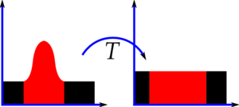
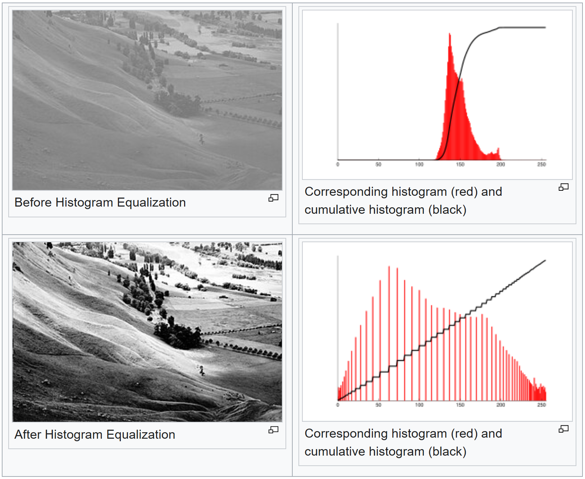

# Case study: 300 million people, one pixel grid

::: notes
The HoloViz "Census 2010" example, one notebook cell per slide. Every cell runs live
on this laptop: edit it, press Shift+Enter, watch the output and the wall time.
Follow the cost: one expensive pass over all rows (aggregation), then cheap work on a
grid of about half a million pixels.
:::

## The data: the 2010 US census {#census-data}

:::: {.columns}
::: {.column width="60%"}
::: medium
**The census.** Every ten years the US counts every resident (Constitution, Art. I §2), to share out the seats of the House of Representatives. Census day 2010: 1 April; 10 questions per household; 308,745,538 people.

**Privacy.** Answers are confidential by law (Title 13: staff sworn for life, up to 5 years in prison); personal records stay closed for 72 years. What gets published are counts per census block, with some households swapped between nearby blocks (2020: differential privacy).

**What we get.** No individuals: one dot per counted person, at a random spot inside its block (11 million blocks, 28 people on average). The race column is the census's self-reported category: **w**, **b**, **a** = non-Hispanic White, Black, Asian; **h** = Hispanic, of any race; **o** = everyone else.
:::
:::
::: {.column width="40%"}
::: {style="--diagram-h: 600px"}
```{=html}

```
:::
:::
::::

::: source
census.gov: 2010 Census Briefs C2010BR-01, -02; Title 13 U.S.C. · Cooper Center: Racial Dot Map (2013, archived) · [examples.holoviz.org: Census](https://examples.holoviz.org/gallery/census/census.html)
:::

::: notes
- The census: constitutionally required, conducted by the US Census Bureau; the
  apportionment of the 435 House seats follows it. 2010 was a short form: "10
  questions, 10 minutes". Puerto Rico is counted separately and is not in the 308.7 M.
- Privacy, in layers:
  - Title 13 §9: no publication that identifies a person or household; §214 and
    census.gov: up to 5 years in prison and a fine of up to $250,000 (via general
    federal law) for disclosure. Employees are sworn for life.
  - The 72-year rule: personal records go to the National Archives and are released
    only after 72 years (the 1950 census was released on 1 April 2022).
  - Published 2010 tables: block totals exact, but some households swapped with
    similar households in nearby blocks, more likely if their race was rare in the
    block. So in our data the number of dots per block is right, a few race labels are
    not. For 2020 the Bureau switched to differential privacy (noise below the state
    level).
  - The dot map adds its own layer: dots are placed at random within blocks.
- Lineage: Summary File 1, table P5 ("Hispanic or Latino origin by race", per block)
  → the Racial Dot Map (Dustin Cable, Weldon Cooper Center, UVA, 2013; 308,745,538
  dots, all 50 states and DC) → the HoloViz example: the contiguous US, 306,675,004
  rows, which is the national total minus Alaska and Hawaii (two people fewer; no
  source explains the difference).
- The five categories come from the census's two separate questions: Hispanic origin
  (an ethnicity, any race) and race. "o" = all other non-Hispanic answers: Native
  American, Pacific Islander, "some other race" and multiracial.
:::

## A note on ethics: race in the data {#census-ethics}

::: {.medium style="font-size: 29px;"}
- **Why race is in the US census:** asked by law and self-identified, to enforce civil and voting rights. The Bureau calls its categories "a social definition of race", not a biological one.
- **Seen from Europe,** asking people for their race is unusual and uncomfortable. The GDPR prohibits processing data "revealing racial or ethnic origin" except in narrow cases, and adds that the term does not imply "acceptance … of theories which attempt to determine the existence of separate human races". France bars ethnic statistics; Hungary's 2022 census asked about ethnicity only voluntarily, and not about race at all.
- **Why we still use this data:** it is a famous, public, aggregated benchmark for big-data visualisation. We read the maps as a technical demo: where people were counted, in the census's own categories. They say nothing about individuals, and nothing for or against any group.
- **The lesson that carries over:** visualisation persuades. The same map can inform or stigmatise; choose what you show, and think about how it will be read.
:::

::: source
census.gov: About race · GDPR Art. 9(1) and Recital 51 · Conseil constitutionnel, décision 2007-557 DC · KSH: Census 2022 questionnaire
:::

::: notes
- US: race and Hispanic origin are asked because federal law requires the data:
  civil-rights enforcement, the Voting Rights Act (redistricting), equal employment
  under the Civil Rights Act of 1964. Answers are self-identification; since 2000
  people can tick more than one race. (In 2024 the US revised its standards to one
  combined race/ethnicity question, with a new Middle Eastern or North African
  category.)
- Europe: GDPR Art. 9(1) lists racial or ethnic origin among the special categories
  of personal data; Recital 51 distances the Union from theories of separate human
  races. Anonymous statistics are outside the GDPR (Recital 26), which is also the
  status of our aggregated, randomized data.
- France: the Constitutional Council (2007) ruled that studies of diversity may use
  objective data but may not be based on ethnic origin or race.
- Hungary: the 2022 census was mandatory, but the questions on ethnicity, mother
  tongue, religion and health were voluntary (86 % answered the ethnicity question);
  there is no race question.
- Say it plainly: the demo is about computing and seeing 300 million points. Any
  pattern on the maps has historical and social causes that this lecture does not
  analyse, and none of it says anything about individuals.
:::

## The data: one row per person

```{#load .python .live}
df = dd.read_parquet('./data/census2010.parq', categories=[])
df = df.categorize('race')
df = df.persist()
df.head()
```

:::: cell-aside
::: try
Try `len(df)`, then `df.race.value_counts().compute()`: each is a pass over all 300 M rows
:::
::::

::: notes
- 306,675,004 rows, one per person counted in the 2010 US census.
- easting, northing: Web Mercator coordinates in metres; race: a category.
- Positions are randomized within each census block (for privacy): patterns are real
  at block level, not at house level.
- w, b, a: non-Hispanic White, Black, Asian; h: Hispanic of any race; o: everyone
  else (Native American, Pacific Islander, other, multiracial). See the previous two
  slides for where the categories come from.
- persist() keeps the data in RAM (a few GB); without it Dask streams it from disk on
  every pass: slower, but it runs on small machines.
- categories=[] plus categorize(): a workaround for reading this file with today's
  Dask (explained in the student setup handout).
:::

## Aggregation: 300 million points into one grid

```{#aggregate .python .live}
cvs = ds.Canvas(plot_width, plot_height, *webm(*USA))
agg = cvs.points(df, 'easting', 'northing')
agg
```

:::: cell-aside
::: try
Try `agg.sum()`: how many of the 306 M people fall inside this frame?
:::
::::

::: notes
- Canvas = the bins: 900 × 525 pixels over the continental US. points() counts the
  people per pixel.
- This is the expensive step: one pass over every row. The result is an xarray
  DataArray of 472,500 counts: Big Data in, Small Data out.
- Every slide until the interactive part reuses agg: no more passes over the rows.
- The hint's answer: 306,675,001, all but three people. The file covers only the
  contiguous states. The densest pixel holds about 600,000 people (agg.max()).
:::

## Linear colour scale: almost nothing

```{#linear .python .live}
export(tf.shade(agg, cmap=cm(Greys9), how='linear'))
```

:::: cell-aside
::: try
Try `how='cbrt'` (cube root): between linear and log
:::

::: legend
**People per pixel**, linear
[]{.ramp style="--ramp: linear-gradient(to right, #000000, #252525, #525252, #737373, #969696, #bdbdbd, #d9d9d9, #f0f0f0, #ffffff);"}
[[0]{} [maximum]{}]{.ends}
:::
::::

::: notes
- Colour proportional to count. A handful of very dense pixels (the densest holds
  about 600,000 people) set the maximum, so almost every other pixel lands in the
  darkest greys.
- Only NYC, LA and Chicago show: 300 M points in, almost nothing out.
- Pitfall name (end of the lecture): underutilized range.
:::

## Undersampling: lift the floor

```{#floor .python .live}
export(tf.shade(agg, cmap=cm(Greys9, 0.25), how='linear'))
```

:::: cell-aside
::: try
Try other floors: `cm(Greys9, 0.5)`, or `0` to get the previous slide back
:::

::: legend
**People per pixel**, linear; [black]{.swatch style="--c: #000;"} nobody
[]{.ramp style="--ramp: linear-gradient(to right, #525252, #737373, #969696, #bdbdbd, #d9d9d9, #f0f0f0, #ffffff);"}
[[1]{} [maximum]{}]{.ends}
:::
::::

::: notes
- cm(Greys9, 0.25) drops the darkest quarter of the colormap: the smallest non-zero
  count is already a visible grey, and empty pixels stay black (the background).
- Now we see where anybody lives, but all populated places look the same dim grey.
- Naming: the notebook calls this preventing "undersampling"; datashader's pitfalls
  page calls the problem undersaturation. The checklist at the end uses the latter.
:::

## Logarithmic scale: suddenly, structure

```{#log .python .live}
export(tf.shade(agg, cmap=cm(Greys9, 0.2), how='log'))
```

:::: cell-aside
::: try
Try `how='cbrt'`: another fixed transform, another guess
:::

::: legend
**People per pixel**, logarithmic; [black]{.swatch style="--c: #000;"} nobody
[]{.ramp style="--ramp: linear-gradient(to right, #252525, #525252, #737373, #969696, #bdbdbd, #d9d9d9, #f0f0f0, #ffffff);"}
[[1]{} [maximum]{}]{.ends}
:::
::::

::: notes
- log compresses the huge range of counts: mountains, New England towns, towns strung
  along Midwest roads appear.
- But why log, and not a square root, or log of log? It is a hunch about the shape of
  the distribution, not a principle.
:::

## Histogram equalization: no parameter to guess

```{#eqhist .python .live}
export(tf.shade(agg, cmap=cm(Greys9, 0.2), how='eq_hist'))
```

:::: cell-aside
::: try
Try `cm(Greys9)` without the floor; then `how='linear'` again, to compare
:::

::: legend
**People per pixel**, histogram-equalized (by rank); [black]{.swatch style="--c: #000;"} nobody
[]{.ramp style="--ramp: linear-gradient(to right, #252525, #525252, #737373, #969696, #bdbdbd, #d9d9d9, #f0f0f0, #ffffff);"}
[[fewest]{} [most]{}]{.ends}
:::
::::

::: notes
- eq_hist ranks the pixels: each grey level covers about the same number of pixels,
  whatever the distribution. Nothing to tune; it is datashader's default.
- The price: magnitudes are gone. A pixel twice as bright is not twice as many people.
- Hence the rule: always look at both the linear and the equalized view.
:::

## Histogram equalization

:::: {.columns}
::: {.column width="42%"}
Goal: use every colour for about the same number of pixels

{fig-alt="A peaked histogram transformed by T into a flat one" width="450"}
:::
::: {.column width="58%"}
{fig-alt="A photo before and after histogram equalization, with histograms and cumulative histograms" height="600"}
:::
::::

::: source
[Wikipedia: Histogram equalization](https://en.wikipedia.org/wiki/Histogram_equalization)
:::

::: notes
- The transfer function T is the cumulative histogram: each value is replaced by the
  share of pixels at or below it, so the output histogram is (nearly) flat.
- Wikipedia's photo: values bunched in a narrow peak spread over the whole range after
  equalization, and the cumulative histogram becomes a straight line.
- eq_hist does the same to the aggregate before colouring: rank, not magnitude.
:::

## A perceptually uniform colormap: fire

```{#fire .python .live}
from colorcet import fire
export(tf.shade(agg, cmap=cm(fire, 0.2), how='eq_hist'))
```

:::: cell-aside
::: try
Try `how='linear'`: does a better colormap rescue a linear scale?
:::

::: legend
**People per pixel**, histogram-equalized; [black]{.swatch style="--c: #000;"} nobody
[]{.ramp style="--ramp: linear-gradient(to right, #680100, #a10400, #dd0c00, #fd5800, #ff9d00, #ffd508, #ffffff);"}
[[fewest]{} [most]{}]{.ends}
:::
::::

::: notes
- fire (from colorcet) is perceptually uniform: equal steps in the data look like
  equal steps in colour, from dark red through orange and yellow to white.
- With eq_hist, every colour step also covers about the same number of pixels.
:::

## …versus matplotlib's hot

```{#hot .python .live}
from matplotlib.cm import hot
export(tf.shade(agg, cmap=hot, how='eq_hist'))
```

:::: cell-aside
::: try
Flip back and forth with the previous slide: where does hot hide detail?
:::

::: legend
**People per pixel**, histogram-equalized
[]{.ramp style="--ramp: linear-gradient(to right, #0b0000, #790000, #ea0000, #ff5c00, #ffca00, #ffff56, #ffffff);"}
[[fewest]{} [most]{}]{.ends}
:::
::::

::: notes
- hot is not perceptually uniform: in some stretches the colour barely changes to the
  eye, and the detail mapped there disappears.
- Same data, same equalization: only the colormap differs.
- Pitfall name: nonuniform colormapping.
:::

## viridis

```{#viridis .python .live}
from datashader.colors import viridis
export(tf.shade(agg, cmap=cm(viridis), how='eq_hist'))
```

:::: cell-aside
::: try
Try another colorcet map: `from colorcet import bmy`, then `cmap=cm(bmy)`
:::

::: legend
**People per pixel**, histogram-equalized
[]{.ramp style="--ramp: linear-gradient(to right, #440154, #443983, #30688e, #20918c, #35b779, #8ed744, #fee724);"}
[[fewest]{} [most]{}]{.ends}
:::
::::

::: notes
- viridis: perceptually uniform, readable with the common forms of colour blindness,
  and matplotlib's default colormap since version 2.0.
- No floor here: the sparsest pixels are dark purple, only just distinguishable from
  the black background.
:::

## A colormap that asks a question: the top 1 %

```{#top1 .python .live}
grays2 = cm([(i,i,i) for i in np.linspace(0, 255, 99)])
grays2 += ["red"]
export(tf.shade(agg, cmap=grays2, how='eq_hist'))
```

:::: cell-aside
::: try
Try the top 10 %: `linspace(0, 255, 90)` and `grays2 += ["red"]*10`
:::

::: legend
**People per pixel**, histogram-equalized
[]{.ramp style="--ramp: linear-gradient(to right, #000000, #ffffff);"}
[[fewest]{} [most]{}]{.ends}
[top 1 % of populated pixels]{.swatch style="--c: red;"}
:::
::::

::: notes
- After equalization, 1 % of the colormap is 1 % of the (populated) pixels: 99 grey
  levels plus one red one colour the densest 1 % red.
- The parameter comes from the question ("where is the top 1 %?"), not from the data.
:::

## Categories: one grid per race

```{#create_image .python .live}
def create_image(longitude_range, latitude_range,
                 w=plot_width, h=plot_height):
    x_range, y_range = webm(longitude_range, latitude_range)
    cvs = ds.Canvas(plot_width=w, plot_height=h,
                    x_range=x_range, y_range=y_range)
    agg = cvs.points(df, 'easting', 'northing', ds.by('race'))
    return tf.shade(agg, color_key=color_key, how='eq_hist')

export(create_image(*USA))
```

:::: cell-aside
::: try
Try another region: `export(create_image(*cities['Atlanta']))`
:::

::: {.legend .categories}
[White]{.swatch style="--c: aqua;"} [Black]{.swatch style="--c: lime;"} [Asian]{.swatch style="--c: red;"} [Hispanic]{.swatch style="--c: fuchsia;"} [Other]{.swatch style="--c: yellow;"}\
Hue: mix of the groups in a pixel; brightness: number of people (equalized)
:::
::::

::: notes
- ds.by('race') keeps one count per race per pixel: a 900 × 525 × 5 aggregate.
- shade with a color_key mixes the five colours in proportion to the counts; the
  brightness follows the total count (histogram-equalized).
- create_image wraps the whole pipeline for a lon/lat box; the next slides reuse it.
  Each call is a new pass over all rows.
:::

## Lake Michigan

```{#lakemichigan .python .live}
export(create_image(*LakeMichigan))
```

:::: cell-aside
::: try
Try your own box: `export(create_image((-88.0, -87.5), (41.7, 42.1)))`
:::

::: {.legend .categories}
[White]{.swatch style="--c: aqua;"} [Black]{.swatch style="--c: lime;"} [Asian]{.swatch style="--c: red;"} [Hispanic]{.swatch style="--c: fuchsia;"} [Other]{.swatch style="--c: yellow;"}\
Hue: mix of the groups in a pixel; brightness: number of people (equalized)
:::
::::

::: notes
- Same function, smaller box: the same number of bins over a smaller area, so each
  pixel covers fewer people and more detail appears.
- Chicago and Milwaukee on the lake shore; small towns across the farmland.
:::

## Chicago

```{#chicago .python .live}
export(create_image(*Chicago))
```

:::: cell-aside
::: try
Try fewer, bigger bins: `create_image(*Chicago, w=225, h=131)`
:::

::: {.legend .categories}
[White]{.swatch style="--c: aqua;"} [Black]{.swatch style="--c: lime;"} [Asian]{.swatch style="--c: red;"} [Hispanic]{.swatch style="--c: fuchsia;"} [Other]{.swatch style="--c: yellow;"}\
Hue: mix of the groups in a pixel; brightness: number of people (equalized)
:::
::::

::: notes
- Chicago: the boundaries between neighbourhoods of different groups are strikingly
  sharp.
- Remember: positions are randomized within census blocks, so the boundaries are real
  at block level.
:::

## Chinatown: individual people

```{#chinatown .python .live}
export(tf.spread(create_image(*Chinatown), px=plot_width//400))
```

:::: cell-aside
::: try
Try `px=0` (no spreading), then `px=5`: spreading changes the display, not the data
:::

::: {.legend .categories}
[White]{.swatch style="--c: aqua;"} [Black]{.swatch style="--c: lime;"} [Asian]{.swatch style="--c: red;"} [Hispanic]{.swatch style="--c: fuchsia;"} [Other]{.swatch style="--c: yellow;"}\
Each dot: one person
:::
::::

::: notes
- About 3 km × 2 km of Chicago: at this scale a pixel holds one person or none.
- tf.spread enlarges every point by px pixels so that single people become visible. It
  is a display step: the aggregate is unchanged.
:::

## Other cities

<!-- Tiles are 380×220 (the notebook's 450×260, same aspect) so both rows fit between the slide title and the footer. -->

```{#cities .python .live layout="wide"}
tf.Images(*[export(create_image(*r, w=380, h=220)).rename(name)
            for name, r in cities.items()]).cols(3)
```

::: {.try .inline style="top: 235px;"}
Try `w=95, h=55`: 16× fewer bins; does the wall time drop?
:::

::: {.legend .categories .top}
[White]{.swatch style="--c: aqua;"} [Black]{.swatch style="--c: lime;"} [Asian]{.swatch style="--c: red;"} [Hispanic]{.swatch style="--c: fuchsia;"} [Other]{.swatch style="--c: yellow;"}\
Hue: mix of the groups; brightness: number of people
:::

::: notes
- Six cities, six calls to create_image: six full passes over the 300 M rows.
- The hint's answer: barely (on the lecture laptop about 1.1 s → 0.8 s). The cost is
  per row, not per bin.
- Compare the patterns: each city has its own geography of segregation and mixing.
:::

## Aggregates are data: querying the grid

```{#black .python .live}
cvs = ds.Canvas(plot_width=plot_width, plot_height=plot_height)
aggc = cvs.points(df, 'easting', 'northing', ds.by('race'))
export(tf.shade(aggc.sel(race='b'), cmap=cm(Greys9, 0.25),
                how='eq_hist'))
```

:::: cell-aside
::: try
Try `race='h'` (Hispanic) or `race='a'` (Asian)
:::

::: legend
**Black residents per pixel**, histogram-equalized; [black]{.swatch style="--c: #000;"} none
[]{.ramp style="--ramp: linear-gradient(to right, #525252, #737373, #969696, #bdbdbd, #d9d9d9, #f0f0f0, #ffffff);"}
[[fewest]{} [most]{}]{.ends}
:::
::::

::: notes
- One more pass: aggc holds all five races per pixel, over the full extent of the data.
- The aggregate is a plain xarray array (y, x, race): .sel(race='b') picks one layer, a
  2D grid, shaded like the grey maps before.
:::

## Pixels where four groups all live

```{#allfour .python .live}
agg2 = aggc.where((aggc.sel(race=['w','b','a','h']) > 0)
                  .all(dim='race')).fillna(0)
export(tf.shade(agg2, color_key=color_key, how='eq_hist'))
```

:::: cell-aside
::: try
Try requiring just two groups: `['w','b']`
:::

::: {.legend .categories}
[White]{.swatch style="--c: aqua;"} [Black]{.swatch style="--c: lime;"} [Asian]{.swatch style="--c: red;"} [Hispanic]{.swatch style="--c: fuchsia;"} [Other]{.swatch style="--c: yellow;"}\
Only pixels where White, Black, Asian and Hispanic residents all live
:::
::::

::: notes
- where() keeps the pixels in which each of the four groups has at least one resident;
  fillna(0) empties the rest.
- A query on the aggregate, not on the raw rows: the wall time is tiny.
:::

## More Black than white residents

```{#moreblack .python .live}
export(tf.shade(aggc.where(aggc.sel(race='w') < aggc.sel(race='b'))
                    .fillna(0),
                color_key=color_key, how='eq_hist'))
```

:::: cell-aside
::: try
Try `'h'` instead of `'b'`: more Hispanic than white residents
:::

::: {.legend .categories}
[White]{.swatch style="--c: aqua;"} [Black]{.swatch style="--c: lime;"} [Asian]{.swatch style="--c: red;"} [Hispanic]{.swatch style="--c: fuchsia;"} [Other]{.swatch style="--c: yellow;"}\
Only pixels with more Black than white residents
:::
::::

::: notes
- Pixel-wise comparison of two layers of the aggregate: again only array arithmetic,
  no pass over the rows.
- The pattern follows the South and the big cities' historically Black neighbourhoods.
:::

# Live: datashader behind an interactive plot

::: notes
So far every image was static. To zoom and pan, datashader has to run again for every
new view. HoloViews does that for us, inside a Bokeh plot in the browser.
:::

## A colour key needs a plotting library

```{#legend .python .live}
races = {'w':'White', 'b':'Black', 'a':'Asian', 'h':'Hispanic', 'o':'Other'}
color_points = hv.NdOverlay({races[k]: hv.Points([webm(-80,40)]).opts(color=v, size=0)
                             for k, v in color_key.items()})
color_points.opts(clone=True, xaxis=None, yaxis=None, height=190, width=135)
```

:::: cell-aside
::: try
The key is made of five invisible points (`size=0`): try `size=10`
:::
::::

::: notes
- A datashaded image is just pixels: it has no axes and no legend.
- The notebook's trick: five points of size 0, one per race, give Bokeh something to
  list in a legend. Overlaid on the map on the next slide.
- Recent HoloViews also adds its own legend for categorical datashade (the one-letter
  codes), so the next slide's key lists both.
:::

## Re-aggregating on every zoom

```{#racemap .python .live layout="wide"}
points = hv.Points(hv.Dataset(df, kdims=['easting', 'northing'], vdims=['race']))
shaded = datashade(points, color_key=color_key, min_alpha=100, aggregator=ds.by('race'))
race = dynspread(shaded, threshold=0.8).opts(bgcolor='black')
tiles.EsriImagery().opts(alpha=0.5, bgcolor='black') * race * color_points * labels
```

::: {.try .inline style="top: 287px;"}
Zoom into a city with the mouse wheel: every zoom re-aggregates all 300 M points
:::

::: notes
- datashade = rasterize + shade as a dynamic operation: on every zoom or pan, Bokeh
  sends the new ranges to Python, datashader aggregates the visible range at screen
  resolution, and only the RGB image comes back.
- dynspread enlarges points when you zoom in far enough for them to become sparse.
- Underneath: Esri satellite imagery at 50 % opacity; on top: place labels.
:::

## Population density, with hover

```{#popmap .python .live layout="wide"}
population = dynspread(rasterize(points)).opts(
    cnorm='eq_hist', cmap='fire', colorbar=True, tools=['hover'])
tiles.EsriImagery().opts(alpha=0.5, bgcolor='black') * population * labels
```

::: {.try .inline style="top: 261px;"}
Hover over a city: the tooltip shows the count; then try `cnorm='linear'`
:::

::: notes
- rasterize instead of datashade: the browser receives the aggregate (the counts), not
  an RGB image, and Bokeh does the colouring.
- So the colorbar shows real counts and hover reports the value under the mouse; the
  payload is still one number per pixel.
:::
