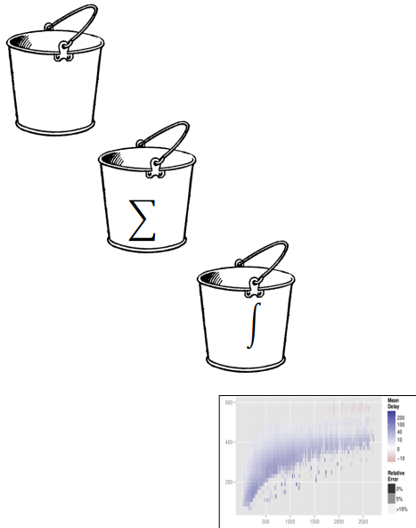
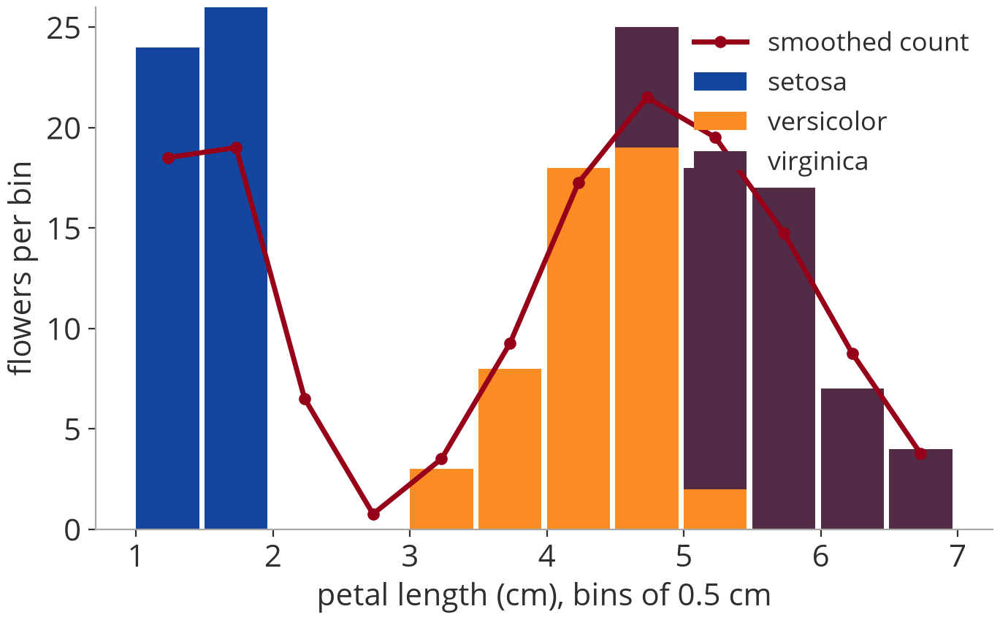
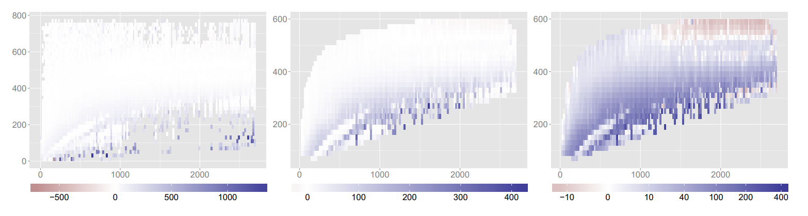

# Bin, summarize, smooth, plot

::: notes
Wickham's framework: four steps that turn any number of rows into about as many values
as there are pixels. Datashader, after this section, is this framework with pixels as
the bins.
:::

## The framework in four steps

:::: {.columns}
::: {.column width="68%"}
- **Bin:** fixed-width bins over *n* dimensions
- **Summarize:** per-bin summaries over *m* dimensions
- **Smooth:** smooth, peel, transform distributions
- **Plot**
:::
::: {.column width="32%"}
{fig-alt="Buckets for binning, a sum sign for summarizing, an integral sign for smoothing, and a small plot" height="440"}
:::
::::

::: source
H. Wickham: [Bin-summarise-smooth: a framework for visualising large data](https://vita.had.co.nz/papers/bigvis.pdf), tech report, 2013
:::

::: notes
- Bin and summarize condense the raw data in one O(n) pass to about as many values as
  there are pixels; smoothing removes the noise that small bins leave; the plot only
  ever sees the small result.
- Every step is a group-by or a vectorised operation: the paper uses R (bigvis), the
  same works in pandas, Dask, Spark, SQL.
- Fixed-width bins: fast, extend from 1D to nD, and "there is little evidence that
  variable binwidths do better" (Wickham). The paper numbers bins from 1 and keeps 0
  for missing values; the examples here count from 0.
- Next: the four steps by hand on a data set small enough to print.
:::

## Iris example: bin {#iris-bin}

:::: {.columns}
::: {.column width="57%"}
::: small
**Fisher's Iris data:** 150 flowers, 3 species, 4 measurements in cm

| # | sepal length | sepal width | petal length | petal width | species | **bin** |
|---|---|---|---|---|---|---|
| 1 | 5.1 | 3.5 | 1.4 | 0.2 | setosa | **0** |
| 2 | 4.9 | 3.0 | 1.4 | 0.2 | setosa | **0** |
| … | | | | | | |
| 51 | 7.0 | 3.2 | 4.7 | 1.4 | versicolor | **7** |
| 52 | 6.4 | 3.2 | 4.5 | 1.5 | versicolor | **7** |
| … | | | | | | |
| 101 | 6.3 | 3.3 | 6.0 | 2.5 | virginica | **10** |
| 102 | 5.8 | 2.7 | 5.1 | 1.9 | virginica | **8** |
| … | | | | | | |
| 150 | 5.9 | 3.0 | 5.1 | 1.8 | virginica | **8** |
:::
:::
::: {.column width="43%"}
::: medium
**Bin** the petal length: 12 fixed-width bins of 0.5 cm, starting at 1.0 cm

$$b = \left\lfloor \frac{x - 1.0}{0.5} \right\rfloor$$

Flower 51: $\lfloor (4.7 - 1.0) / 0.5 \rfloor = \lfloor 7.4 \rfloor = 7$

The bin is one more integer column, computed row by row: one pass, no data moves.
:::
:::
::::

::: source
Iris data: R. A. Fisher, 1936 (as shipped with R)
:::

::: notes
- Fisher's Iris data: the classic small data frame of statistics. 150 rows, 5 columns:
  four measurements and the species (50 each of setosa, versicolor, virginica).
- We bin one variable, petal length (1.0 to 6.9 cm), into 12 bins of 0.5 cm.
- Binning adds a column, nothing else: each row's bin depends only on that row. That is
  why it parallelises and streams trivially, over 150 rows or 300 million.
:::

## Iris example: summarize, smooth, plot {#iris-summarize}

:::: {.columns}
::: {.column width="45%"}
::: small
| bin | petal length | flowers | mean petal width | smoothed |
|---|---|---|---|---|
| 0 | 1.0–1.5 | 24 | 0.22 | 18.5 |
| 1 | 1.5–2.0 | 26 | 0.27 | 19 |
| 2 | 2.0–2.5 | 0 | – | 6.5 |
| 3 | 2.5–3.0 | 0 | – | 0.75 |
| 4 | 3.0–3.5 | 3 | 1.03 | 3.5 |
| 5 | 3.5–4.0 | 8 | 1.14 | 9.25 |
| 6 | 4.0–4.5 | 18 | 1.27 | 17.25 |
| 7 | 4.5–5.0 | 25 | 1.55 | 21.5 |
| 8 | 5.0–5.5 | 18 | 1.97 | 19.5 |
| 9 | 5.5–6.0 | 17 | 2.05 | 14.75 |
| 10 | 6.0–6.5 | 7 | 2.11 | 8.75 |
| 11 | 6.5–7.0 | 4 | 2.15 | 3.75 |
:::
:::
::: {.column width="55%"}
{fig-alt="Bar chart of flowers per petal-length bin, stacked by species: setosa in the first two bins, a gap, then versicolor and virginica overlapping; a red line shows the smoothed count" height="400"}

::: small
**Summarize:** count (distributive), mean petal width (algebraic: carry *n* and Σ), count per species (like datashader's `by()`).
**Smooth:** each bin gets ¼ · left + ½ · itself + ¼ · right.
**Plot:** 12 bars, however many flowers.
:::
:::
::::

::: notes
- Summarize: per bin, the number of flowers, the mean petal width, and the count per
  species (the stacked colours). One more group-by over the bin column.
- The summary has 12 rows whatever the input: 150 flowers or 150 million.
- Smooth: the simplest kernel, weights ¼, ½, ¼ over neighbouring bins. It fills the
  empty bins 2 and 3 a little and rounds off the peaks. With 150 rows smoothing is
  cosmetic; with millions of rows and thousands of bins it removes noise.
- Plot: the gap between setosa and the other two species is visible at once; so is the
  overlap of versicolor and virginica around 5 cm.
:::

## Binning is a logical operation

- A histogram, generalised: each bin is just an integer
- Computing it is "just a perfect hash"; no data moves
- *d* binned dimensions, bin $x_j$ out of $n_j$ in dimension $j$:

$$
\begin{aligned}
b &= x_1 + x_2 n_1 + x_3 n_1 n_2 + \dots + x_d \textstyle\prod_{i=1}^{d-1} n_i \\
  &= x_1 + n_1\bigl(x_2 + n_2(x_3 + \dots + n_{d-1} x_d)\bigr)
\end{aligned}
$$

:::: {.columns}
::: {.column width="52%"}
::: medium
**Example:** Iris flower 51, petal 4.7 × 1.4 cm, bins of 0.5 cm

- length: $x_1 = \lfloor (4.7 - 1.0) / 0.5 \rfloor = 7$ of $n_1 = 12$
- width: $x_2 = \lfloor 1.4 / 0.5 \rfloor = 2$ of $n_2 = 6$
- $b = x_1 + x_2 n_1 = 7 + 2 \cdot 12 = 31$
:::
:::
::: {.column width="48%"}
::: {style="--diagram-h: 250px"}
```{=html}

```
:::
:::
::::

::: notes
- Wickham calls it a "monotone minimal perfect hash": every combination of
  per-dimension bins gets its own integer, and the integers are dense.
- The example: 12 × 6 = 72 possible bins, numbered row by row; bin 31 holds 7 flowers
  (flower 51 and six others). Only 20 of the 72 bins hold any flower (tinted).
- Store the bins in a plain array when most are occupied, in a hash map when they are
  sparse, as here.
- The second line of the formula is the same index in Horner form: one multiply-add
  per dimension.
- Notation: the old slide used m here; d avoids a clash with the m summary dimensions.
:::

## Keeping neighbours close: Z-order

:::: {.columns}
::: {.column width="54%"}
::: {style="--diagram-h: 330px"}
```{=html}

```
:::
:::
::: {.column width="46%"}
::: medium
**Why it matters here:** big aggregates and map tiles are stored and fetched by key.

- A zoom or pan window is a rectangle of bins: in Z-order a few long runs of keys, in row-major order one short run per row of bins. Fewer disk reads, cache misses, files touched.
- Map tiles are keyed this way: a tile's key starts with its parent's key (next sections).
:::
:::
::::

- Row-major order keeps only *x*-neighbours adjacent
- Z-order (Morton) interleaves the bits of the bin coordinates: 2D blocks stay together

::: source
Microsoft: Bing Maps Tile System · Delta Lake docs: Z-ordering · Moon et al., IEEE TKDE 13(1), 2001
:::

::: notes
- The formula on the previous slide is row-major order: the bin below a given bin is
  n₁ positions away. Z-order (Morton order, the Lebesgue curve) sorts bins by the
  interleaved bits of their coordinates, so every aligned 2×2, 4×4, … block is one
  contiguous stretch.
- Why we care in this lecture: interactive views ask for rectangles (the viewport).
  The number of contiguous key ranges such a window needs grows with its perimeter,
  not its area (Moon et al., TKDE 2001; the Hilbert curve needs even fewer than
  Z-order).
- Where the students will meet it:
  - Web map tiles: Bing Maps' quadkeys interleave the bits of tile y and x and read the
    result as a base-4 number; a child tile's key starts with its parent's. Neighbouring
    tiles are requested together, so they sit on the same disk blocks.
  - Geohashes (and Redis GEO's 52-bit scores) interleave longitude and latitude bits.
  - Data lakes: Delta Lake's OPTIMIZE … ZORDER BY and Iceberg's z-order sort colocate
    related rows in the same files, so per-file min/max statistics can skip most files
    for a region query. The benefit drops with each extra column.
  - The Hilbert curve, Z-order's better-behaved cousin: spatialpandas (HoloViz)
    partitions data along it; Google's S2 cells are built on it.
:::

## Per-bin summaries: which ones distribute?

| | Examples | Combining partial results |
|--------|------------------|--------------------|
| **Distributive** | count, sum, min, max | directly: the sum of the counts |
| **Algebraic** | mean, sd, higher moments | via a fixed-size state, e.g. (n, Σx, Σx²) |
| **Holistic** | median, quantiles, mode, count distinct | no bounded state: pay in full, or approximate |

::: {style="--diagram-h: 270px; margin-top: 18px;"}
```{=html}

```
:::

::: source
Categories: Gray et al., "Data Cube", Data Mining and Knowledge Discovery 1(1), 1997
:::

::: notes
- Why it matters: the data is split across partitions, cores and machines. Each
  partition computes its partial result, then they are merged.
- The three pictures use the same five numbers, split 2, 3, 5 and 1, 4:
  - sum: 10 + 5 = 15, exact;
  - mean: carry (n, Σ), merge to (5, 15), mean 3. Averaging the two means gives 2.92:
    wrong whenever the partitions differ in size;
  - median: the medians 3 and 2.5 say nothing about the median of the union (3); you
    need all the values, or a sketch (next slide).
- Gray et al. list median, mode and rank as holistic; count distinct as holistic is
  Wickham's use of the same idea.
:::

## Holistic summaries: approximate them

| Summary | Sketch | Idea |
|--------|-------|-------------------------|
| count distinct | HyperLogLog | ≈ 2 % error for 10⁹ distinct values in 1.5 kB |
| median | remedian | medians of groups of *b*, then medians of those; O(log n) memory |
| quantiles | t-digest | clusters shrink toward the tails: accurate extreme quantiles; mergeable |
| quantiles | KLL | provably optimal space for ε-approximate ranks; mergeable |

::: source
Flajolet et al., AofA 2007 · Rousseeuw & Bassett, JASA 1990 · Dunning & Ertl, arXiv 2019 · Karnin, Lang & Liberty, FOCS 2016
:::

::: notes
- A sketch is a small, mergeable summary that answers a holistic question
  approximately, with a known error.
- HyperLogLog (Flajolet et al. 2007): one pass, m small registers, standard error about
  1.04/√m; merging is a register-wise max. In most databases as approx_count_distinct.
- Remedian (Rousseeuw & Bassett 1990): with base b and n = bᵏ, k arrays of size b; the
  historical answer for the median.
- t-digest (Dunning & Ertl 2019): error relative to how far out the quantile is, so the
  tails (p99 latency!) are accurate; digests merge well in practice.
- KLL (Karnin, Lang, Liberty 2016): additive rank error εn in optimal space; mergeable.
:::

## Smooth, peel, transform {#smooth-peel-transform}

- **Smooth:** a weighted average over neighbouring bins (kernel, bandwidth *h*)
- **Peel:** drop the sparsest outer bins, often under 1 % of the data
- **Transform** the summary before colouring: log, modulus, rank

{fig-alt="Three tile plots of average flight delay by distance and speed: the raw view dominated by a few extreme bins, the peeled view of the middle 99.5 % of the data, and the view with the delay modulus-transformed, where structure becomes visible" width="1180"}

::: small
76 million US flights: average delay (colour, minutes) by distance (x, miles) and speed (y, mph). Left: all bins; centre: peeled to the middle 99.5 % of the data; right: delay modulus-transformed. Faster flights have shorter delays; a group of short, slow flights has almost none.
:::

::: source
H. Wickham: [Bin-summarise-smooth: a framework for visualising large data](https://vita.had.co.nz/papers/bigvis.pdf), tech report, 2013, Fig. 1
:::

::: notes
- The third step of the framework, in one picture: Wickham's Figure 1, on the US
  on-time flight data (domestic flights 2000–2011). Each tile is a 2D bin of distance ×
  speed; colour is the per-bin mean delay.
- Left: unusable. A few bins with extreme mean delays (and a few absurd speeds) set
  both the axes and the colour range.
- Centre: peeling. Removing the least populated outer bins (the paper peels off the
  convex hull step by step, here keeping the middle 99.5 % of the data) refocuses the
  axes on the bulk.
- Right: the modulus transformation (John & Draper 1980; a Box-Cox variant for
  positive and negative values) shrinks the extreme delays, so typical values get the
  colour range. Now the story shows: faster flights, shorter delays (red); short, slow
  flights with almost no delay (white, bottom left).
- Outliers are not thrown away for good: "it is better to partition the analysis to
  look separately at the common and at the unusual."
- Smoothing (not in this figure): each bin's summary becomes a kernel-weighted average
  of its neighbours; the bandwidth h sets how far that reaches (the paper picks it by
  leave-one-out cross-validation). The Iris example's ¼-½-¼ was a tiny kernel. Why it
  matters: the cheap per-bin statistics (mean) are sensitive to outliers, the robust
  ones (median) are holistic and slow; smoothing across bins "makes it possible to use
  fast statistics with low breakdown points" (Wickham).
- Rank transforms go one step further: histogram equalization, live in the census
  part.
:::


<!-- flights live case study goes here -->
