# Too many observations

::: notes
What goes wrong when a data set has far more rows than the screen has pixels, and
which ways out work.
:::

## The data frame: rows and columns {#data-frames}

- One row per *observation* (a person, a trip, a log line), one column per *variable*
- The shared model of statistics (R, pandas), data science and BI (SQL tables)
- The same data can be stored *wide* or *narrow*

::: {style="--diagram-h: 390px"}
```{=html}

```
:::

::: source
H. Wickham: [Tidy Data](https://doi.org/10.18637/jss.v059.i10), Journal of Statistical Software 59(10), 2014
:::

::: notes
- A data frame is a table of typed columns: R's data.frame, pandas, Polars and Spark
  DataFrames, SQL tables, the fact tables behind BI dashboards.
- Wide: one row per entity, one column per measured variable. Easy to read and to
  compare variables side by side; adding a metric changes the schema.
- Narrow (long): one row per entity, variable and value. A fixed schema that grows in
  rows only: the shape of logs, metrics, event streams, and of today's census file (one
  row per person).
- Converting: melt / pivot in pandas, pivot_longer / pivot_wider in R (tidyr), UNPIVOT /
  PIVOT in SQL.
- Tidy data (Wickham 2014): "each variable is a column, each observation is a row, and
  each type of observational unit is a table". Which shape is tidy depends on what you
  call a variable.
- Today's problem, in these terms: too many rows.
:::

## Too many rows, not too many columns

- This lecture: *too many observations*, from millions to trillions of rows
- "Too many variables" is a different topic

::: {style="--diagram-h: 500px"}
```{=html}

```
:::

::: notes
- Scope: millions to trillions of rows, a handful of columns at a time. Many variables
  (high-dimensional data) need other tools, such as dimensionality reduction.
- Every data set on the chart has more rows than a 4K screen has pixels (red line):
  even the logs of a single Hadoop cluster.
- Sources (checked September 2026; the growing ones are snapshots):
  - HDFS_v1 log: 11.2 M lines, Loghub (github.com/logpai/loghub)
  - NYC yellow-taxi trips 2024: 41,169,720, NYC Open Data (all 2024 TLC trips
    including Uber/Lyft: ≈ 299 M)
  - US domestic flights 2000–2011: ≈ 78 M, Wickham's bigvis paper (next section)
  - US census 2010: 306,675,004 people, HoloViz census example
  - Backblaze Drive Stats: 529,968,464 drive-days (2013 – Q1 2026), one row per drive
    per day
  - English Wikipedia: 1.37 B edits (Special:Statistics)
  - Gaia DR3 (ESA, 2022): 1,811,709,771 sources
  - Azure Public Dataset V2: 1,942,780,023 VM CPU readings over 30 days
  - OpenStreetMap: 10.88 B nodes (planet statistics)
  - Wikimedia: 175.6 B page views by users in 2025 (pageviews API)
  - OpenSky Network: more than 40 trillion ADS-B / Mode S replies, 2013–2025 (OpenSky
    Report 2025, arXiv 2505.06254)
- Coming next: the Rubin Observatory's survey, about 10 TB of images per night, with a
  final catalogue planned at tens of billions of objects.
:::

## The pixel budget

:::: {.columns}
::: {.column width="62%"}
- Even 4K is only ≈ 8.3 M pixels
- A hard upper limit to laying out data
- No upper limit on data size
- Overplotting bites much earlier
:::
::: {.column width="38%"}
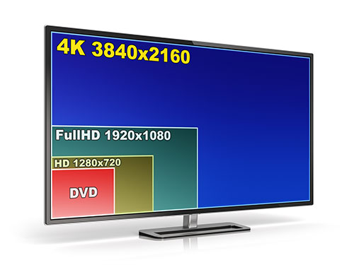{fig-alt="Screen resolutions compared: DVD, HD, Full HD and 4K" height="230"}
:::
::::

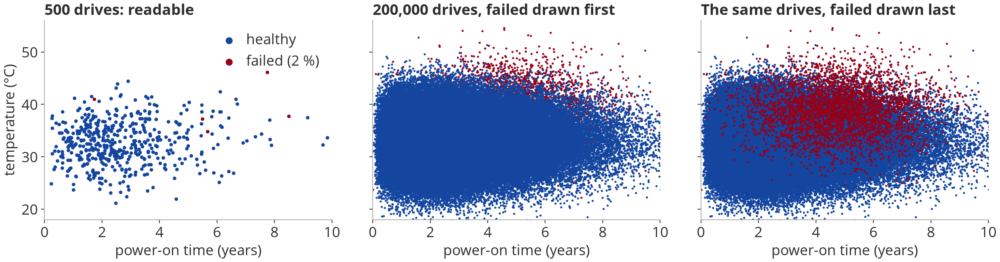{fig-alt="Three scatter plots of drive temperature against power-on time: 500 drives, readable; 200,000 drives with failed ones drawn first, where they almost vanish; the same drives with failed ones drawn last, where they seem to be everywhere" width="1090"}

::: small
Simulated drive fleet, 2 % failed. With 200,000 drives the dots pile up, and whichever colour is drawn last wins.
:::

::: notes
- 3840 × 2160 = 8,294,400 pixels. Every mark needs pixels; the data can grow without
  bound, the screen cannot.
- Long before we run out of pixels, marks cover each other: overplotting.
- The drive example (simulated, loosely modelled on drive-health data like
  Backblaze's): one dot per drive, temperature against age; failed drives run a bit
  older and hotter.
  - 500 drives: fine, the few failed ones stand out.
  - 200,000 drives, failed drawn first: the healthy dots bury them; only a few red
    dots at the hot fringe remain.
  - Same data, failed drawn last: red seems to be everywhere, although it is only 2 %.
- Neither picture shows density: how many drives sit under one pixel. That is what
  aggregation will fix.
:::

## Which charts scale with the number of observations?

::: {.fig-grid layout-ncol=4}
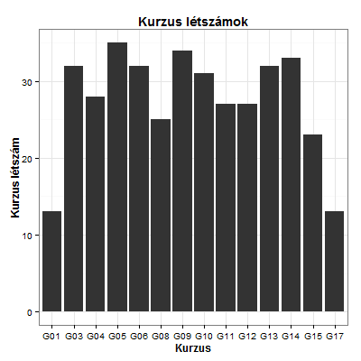{fig-alt="Bar chart of course headcounts"}

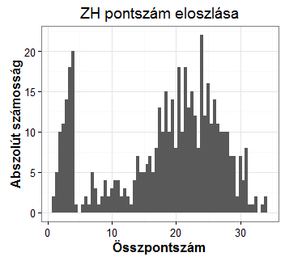{fig-alt="Histogram of exam scores"}

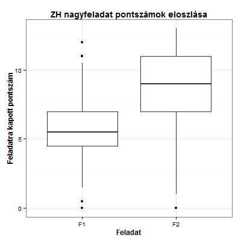{fig-alt="Boxplots of scores for two tasks"}

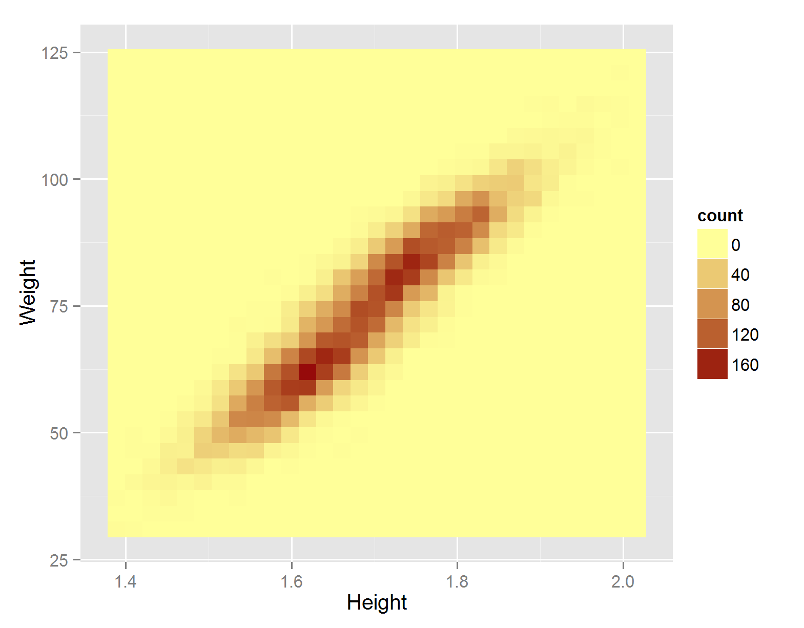{fig-alt="2D binned heatmap of weight versus height"}

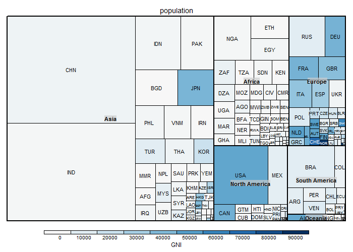{fig-alt="Treemap of population by country"}

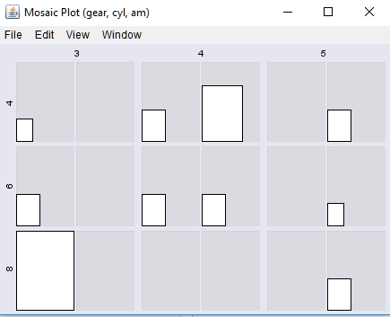{fig-alt="Mosaic plot of gear, cylinders and transmission"}

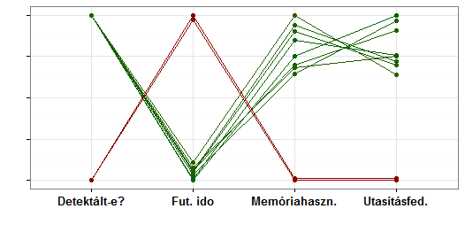{fig-alt="Parallel coordinates plot"}

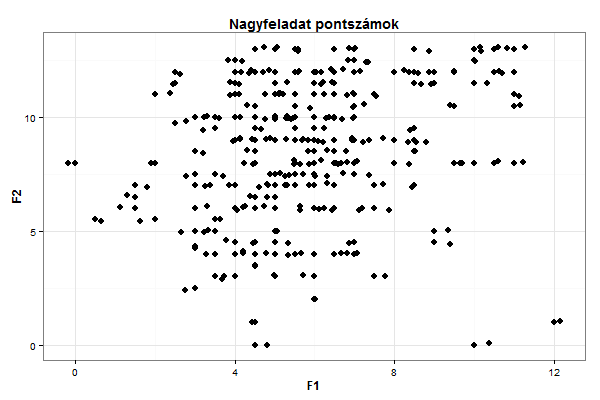{fig-alt="Scatter plot of two homework scores"}
:::

::: notes
- Ask the room before the next slide: which of these still work with a billion rows?
- The Hungarian labels: "Kurzus létszámok" = course headcounts, "ZH pontszám
  eloszlása" = midterm score distribution, "ZH nagyfeladat pontszámok eloszlása" =
  score distribution of the two midterm tasks, "Nagyfeladat pontszámok" = homework
  scores.
:::

## Aggregates scale, one-mark-per-row charts don't

:::: {.columns}
::: {.column width="64%"}
**Scales:** one mark per bin or category

::: {.fig-grid layout-ncol=3 style="--fig-h: 170px"}
{fig-alt="Bar chart of course headcounts"}

{fig-alt="Histogram of exam scores"}

{fig-alt="Boxplots of scores for two tasks"}

{fig-alt="2D binned heatmap of weight versus height"}

{fig-alt="Treemap of population by country"}

{fig-alt="Mosaic plot of gear, cylinders and transmission"}
:::
:::
::: {.column width="36%"}
**Doesn't scale:** one mark per observation

::: {.fig-grid layout-ncol=2 style="--fig-h: 170px"}
{fig-alt="Scatter plot of two homework scores"}

{fig-alt="Parallel coordinates plot"}
:::
:::
::::

::: notes
- Left: summaries. The number of marks depends on the number of bins or categories,
  not on the number of rows.
- The treemap has one rectangle per country (population totals), so it belongs on the
  left; a treemap with one tile per record would not.
- Boxplot caveat: its outlier dots are drawn one by one, and with millions of rows
  there are thousands of them. Letter-value plots (Hofmann, Wickham, Kafadar, JCGS
  2017) replace them with more quantile boxes.
- Right: one mark per row, so they saturate long before the data runs out.
:::

## What works at scale

- (2D) EDA/CDA of (n, m)-dimensional statistical aggregates
- Subsetting: situational (may remain a Big Data problem)
- Sampling: hard to get right
- Much easier to "just process everything"

::: notes
- EDA / CDA: exploratory and confirmatory data analysis. Aggregates over n grouping
  dimensions and m summarised dimensions: exactly what the next section formalises.
- Subsetting only helps if the interesting subset is small, and finding it may itself
  be a Big Data job.
- Sampling: the next three slides.
:::

## Sampling: the curse of dimensionality

Consistent coverage of the sample space as dimensions grow?

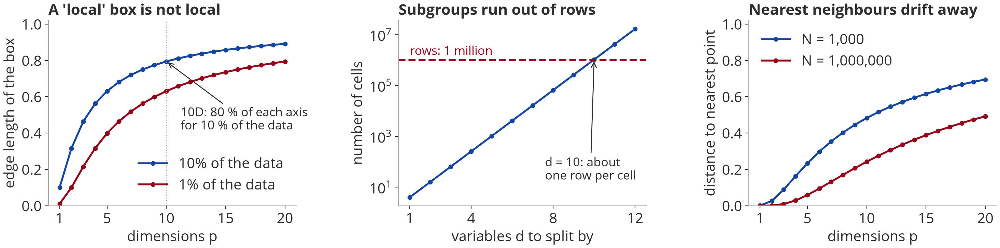{width="1270" fig-alt="Three line charts: the edge of a box holding 10 % of uniform data approaches the full axis as dimensions grow; the number of cells when splitting by d variables with 4 levels passes one million at d = 10; the distance to the nearest point grows with the dimension"}

:::: {.columns .small}
::: {.column width="33%"}
**To achieve a fixed sampling density**\
Uniform data in a unit cube: a box holding a share *r* of it has edge *r*^1/p^. In 10D, 10 % of the data spans 80 % of every axis. 100 points in 1D are as dense as 100^10^ in 10D.
:::
::: {.column width="33%"}
**To maintain statistical power in hypothesis testing**\
Split *n* rows by *d* variables of *k* levels: *k*^d^ cells of *n*/*k*^d^ rows. A cell mean's standard error grows as *k*^d/2^/√*n*. An interaction needs 4× the rows of an equal main effect.
:::
::: {.column width="33%"}
**To keep a consistent distance between nearest-neighbour points**\
The nearest of *N* points lies about *N*^−1/p^ away: halving it takes 2^p^× more points. And distances concentrate: nearest and farthest become almost equally far.
:::
::::

::: source
Hastie et al.: Elements of Statistical Learning, §2.5 · Gelman, Hill, Vehtari: Regression and Other Stories, §16.4 · Beyer et al., ICDT 1999
:::

::: notes
- The term: Bellman (dynamic programming). The point for sampling: a sample that is
  fine for a 1D histogram is far too thin once you slice it by a few more variables.
- Left panel (ESL §2.5, p. 22): for uniform data in the unit hypercube, the edge of a
  sub-cube capturing a fraction r of the data is r^(1/p). In 10 dimensions, capturing
  1 % needs 63 % of each axis, 10 % needs 80 %. Sampling density scales as N^(1/p), so
  100 points in 1D are as dense as 100^10 in 10D.
- Middle panel: cross-classify by d variables with k levels: k^d cells. Standard error
  of a cell mean σ·k^(d/2)/√n. With 1 million rows and 4 levels, d = 10 gives
  1,048,576 cells: about one row per cell. Gelman, Hill & Vehtari (ROS §16.4): "you
  need 4 times the sample size to estimate an interaction that is the same size as the
  main effect".
- Right panel (ESL eq. 2.24): median distance from the centre of the unit ball to the
  nearest of N uniform points, (1 − ½^(1/N))^(1/p): it approaches 1, the boundary, as p
  grows, even for a million points. Beyer et al. (ICDT 1999): under broad conditions the
  ratio of the farthest to the nearest neighbour distance tends to 1, noticeable from
  about 10–15 dimensions.
:::

## Sampling: other traps

:::: {.columns}
::: {.column width="60%"}
- Causal distortions: the return-visitor-ratio problem\
  [Sample 10 % of the *visits* instead of the visitors: a heavy user is almost surely in the sample, but with only a tenth of their visits. Per-visitor measures come out wrong. Fix: sample the unit you analyse (hash the user id, keep all their visits).]{.small}
- Stratified sampling can help, if you know what to stratify on\
  [Split the population into strata known up front (country, device…) and sample each separately. It pays off when strata differ in mean or spread (Neyman allocation: *n*~h~ ∝ *N*~h~ *S*~h~). In exploration, the subgroups that matter are what you are looking for.]{.small}
- Much easier to "just process everything"
:::
::: {.column width="40%"}
::: {.small}
**A toy web site:** 60 % of users visit once, 30 % three times, 10 % ten times. Sample 10 % of the visits:

| | all visits | 10 % sample |
|------------|------|------|
| returning users | 40 % | 17 % |
| visits per user | 2.5 | 1.2 |
| users with 10 visits | 10 % | 32 % |
:::
:::
::::

::: source
Deng, Knoblich, Lu: Applying the Delta Method in Metric Analytics, KDD 2018 · Cochran: Sampling Techniques, 3rd ed., 1977, ch. 5
:::

::: notes
- Return-visitor ratio: the sampling unit (visit) differs from the analysis unit
  (visitor). A user with v visits is in a p = 10 % visit sample with probability
  1 − 0.9^v, and then shows only about v/10 of their visits: heavy users are
  over-represented as users, under-represented in visits. The table is computed exactly
  for that toy population. Web analytics tools that sample sessions have this problem
  for per-user metrics.
- Deng, Knoblich & Lu (KDD 2018) name the distinction: "randomization unit – the
  granularity level where sampling or randomization is performed, and the analysis
  unit – the aggregation level of metric computation."
- Stratified sampling (Cochran, ch. 5): independent simple random samples per
  stratum. The gain over simple random sampling grows with the differences between the
  stratum means; Neyman allocation (n_h ∝ N_h·S_h) adds more when the spreads differ.
  Cochran: "To obtain the full benefit from stratification, the values of the N_h must
  be known."
:::

## Just process everything

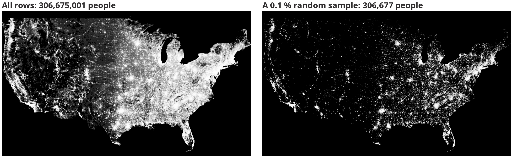{fig-alt="Two maps of the US population: all 306 million people show the sparse West, the Plains and small towns; a 0.1 % random sample of 306,677 people keeps only the cities"}

::: small
The census of the case study, same shading. A 0.1 % sample still has 306,677 rows, but the sparse West, the small towns of the Plains and the roads between them are gone: "the shape of an undersampled distribution can be very difficult or impossible to make out" (datashader's plotting pitfalls). Aggregating every row costs one pass.
:::

::: notes
- Both maps: one grey level per rank of the pixel counts (histogram equalization, as in
  the case study). Left: all rows. Right: a uniform random 0.1 % sample.
- The cities survive sampling; the sparse structure does not. Rare things (outliers,
  small groups, thin roads) are exactly what exploration is for.
- imMens (Liu, Jiang, Heer 2013) makes the same point: a sample "can miss important
  structures or outliers".
- On this laptop, one aggregation pass over all 306 M rows takes well under a second
  once the data is in memory (you will see the wall times live).
:::

## 3D EDA: an aside {#three-d-eda}

<!-- The previous right-hand figure (a 3D datashader experiment on NYC taxi pickups) is still in assets/legacy/s07-3d-scatter-fail.png. -->

:::: {.columns}
::: {.column width="49%"}
**Sometimes it works…**

```{=html}
<video class="video-embed" controls preload="metadata" poster="assets/legacy/s06-nasa-co2-3d.png" src="assets/video/nasa-co2-following.mp4" aria-label="NASA animation of carbon dioxide moving through the atmosphere over a year"></video>
```

::: small
A year of CO₂ from NASA's GEOS model and OCO-2 satellite data: familiar geography, one variable in colour, time as motion.
:::
:::
::: {.column width="51%"}
**…sometimes it doesn't**

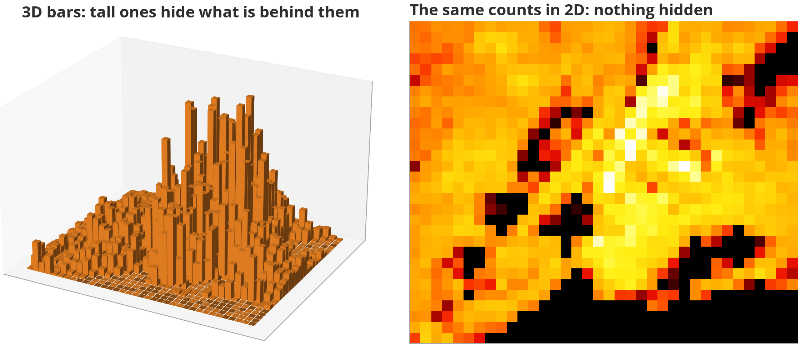{fig-alt="Population of New York City on a 36 by 30 grid, as 3D bars where tall bars hide those behind them, and as a 2D colour grid of the same counts"}

::: small
Population of New York City on a 36 × 30 grid (the case study's census). In 3D, Manhattan's towers hide what stands behind them, and heights are hard to compare in perspective.
:::
:::
::::

::: source
Video: NASA Goddard, [Following Carbon Dioxide Through the Atmosphere](https://svs.gsfc.nasa.gov/12445) (also on [YouTube](https://www.youtube.com/watch?v=syU1rRCp7E8)) · Right: census 2010, New York City
:::

::: notes
- An aside, not the main road: 3D can work, but its exploratory value is situational.
- Left (78 s, plays in place): NASA's GEOS model driven by OCO-2 satellite data,
  September 2014 – August 2015, height exaggerated. It works: familiar geography, one
  variable in colour, time as motion, a story to follow.
- Right: population of New York City counted on a 36 × 30 grid (the case study's
  data). As 3D bars, Manhattan's towers hide what stands behind them, and heights are
  hard to compare in perspective. The same counts as colours show everything at once.
- If the video file is missing on this machine, the poster image shows and the NASA
  link in the source line has the download.
:::
